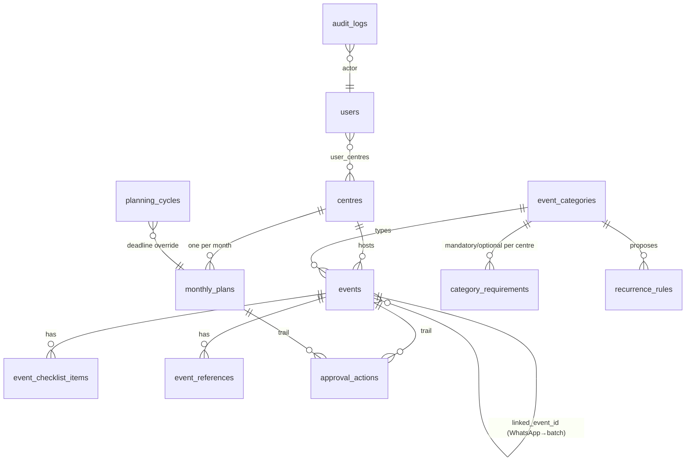
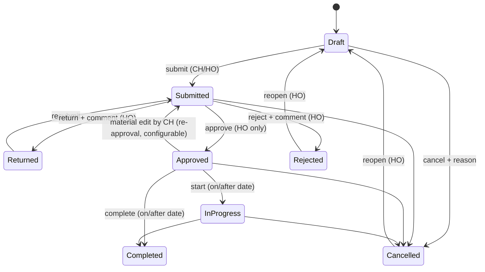

# Architecture & product specification (Phase 1)

## 1. What the product does

Every Centre Head plans next month's events, completes them to a defined standard and submits the plan.
Head Office sees every centre in one place, approves or returns events/plans with comments, and tracks
execution through to recorded outcomes. Nothing is month-specific: every month gets its own plan record and
history is kept forever.

## 2. Users and journeys

| Role | Sees | Can do |
|---|---|---|
| **Super Admin** | Everything | Everything, including creating/editing other Super Admins |
| **Head Office Admin** | All centres | Create/edit/reassign any event, approve/return/reject, review plans, national events, configure categories/requirements/deadlines/recurrence, manage centres and users (except Super Admins), audit log, exports |
| **Centre Head** | Assigned centre(s) only | Create, edit, submit, cancel, start/complete, checklists and links for own centres; submit monthly plan. **Cannot approve.** |
| **Read-only Viewer** | Assigned centres, or all if "Viewer can see all centres" | Dashboards, calendar, events, reports. No edits. |

Core journeys

1. **Centre Head – monthly plan:** My centre → *Open planning workspace* (defaults to next month) → add events
   (category-specific forms) / accept recurring proposals → fix "entries needing attention" → submit plan
   (note required if a mandatory activity is missing) → read feedback on returned items → revise → resubmit.
2. **Head Office – review:** Dashboard shows centres not submitted / incomplete → Approvals queue (per event,
   bulk, or per plan) → comment on returns.
3. **Execution:** On/after the date the Centre Head records actual participation, outcomes and closes the
   event (*Mark completed*). Approved events past their date without an outcome appear as *Overdue*.
4. **National mock:** HO creates one parent → one participation record per centre (drafts in each centre's
   plan) → centres complete venue/expected participants/participation plan → normal approval.

## 3. Key technical decisions

| Decision | Choice | Why | Rejected alternative |
|---|---|---|---|
| Database | **Managed PostgreSQL** (Supabase Pro or Neon) via SQLAlchemy 2 | Durable across redeploys, row locks, constraints, backups; Streamlit Cloud has no persistent disk | SQLite on the app host (wiped on redeploy); Google Sheets (no transactions, no constraints, concurrency loss) |
| Schema changes | **Alembic** migrations, run automatically at start under a Postgres advisory lock | Safe upgrades without manual SQL; two booting processes cannot race | `create_all()` (cannot evolve a live schema) |
| Category-specific fields | Common columns + `details` JSONB validated against a per-category **field schema stored in the DB** | Admins add categories/fields without code; common fields stay queryable | One table per category (code change per category); fully generic EAV (unqueryable) |
| Lifecycle | Single `status` column; approval status and execution status are **derived** | They can never disagree | Separate status columns kept in sync by hand |
| Authorization | Checked in the **service layer on every call**; UI only mirrors it; role-specific navigation means pages a role cannot use are not registered | Tampering with ids, forms or URLs cannot bypass rules | Hiding buttons |
| Authentication | Native username/password, **bcrypt** (12 rounds), lockout after 5 failures/15 min, forced change of temporary passwords, sessions invalidated on password change/deactivation | Zero external setup for 7–20 users | Google/Microsoft SSO via `st.login` – a good v2 option once the org confirms its identity provider |
| Concurrency | **Optimistic locking** (`version` column, SQLAlchemy `version_id_col`) + `SELECT … FOR UPDATE` on transitions | Two people editing the same event: the second save is refused with "changed by X – reload", never silently overwritten | Last-write-wins |
| Calendar | Native Streamlit month grid (buttons in bordered cells) + day agenda + list | No third-party JS component to break on Streamlit upgrades; clicking keeps the signed-in session | `streamlit-calendar` (FullCalendar wrapper) – adds a dependency whose compatibility must be re-verified on every Streamlit release |
| Times | Event date/time stored as **IST wall-clock** DATE/TIME; audit timestamps as UTC `timestamptz`, displayed IST; UI dates DD-MM-YYYY | All centres are in India; avoids DST/offset bugs | Storing event times as UTC instants |

## 4. Data model

Highlights: foreign keys use `RESTRICT` for centres/categories (history can never be orphaned – centres and
users are *deactivated*, never deleted); CHECK constraints on status values, time order, non-negative counts;
unique `(centre, year, month)` on plans; indexes on `(centre_id, event_date)`, date, status, category,
parent and link columns.

## 5. Event lifecycle

Material fields: title, date, start/end time, venue, centre, category.

## 6. Monthly plan rules

* A plan row is created the first time an event exists for that centre-month; history is never deleted.
* **Submit plan** submits all Draft/Returned events in one transaction. It is refused if any entry is
  incomplete, or if a *mandatory* category is short **and** no explanatory note is given.
* **Duplicate protection:** submitting again with nothing new raises "already submitted"; resubmission is
  allowed once something is added or revised (submission count is kept).
* Plan status is recomputed from its events: any Returned → Returned; any Submitted → Submitted; otherwise
  Approved.
* Deadline = HO override for that month, else day *N* (default 25) of the previous month.

## 7. Edge cases handled

* Two batch launches same centre, same date: allowed if slots do not overlap; overlap is **blocked**.
  Other slot-using categories overlapping are **flagged** (⚠️) not blocked. WhatsApp campaigns never clash.
* Cancelled/rejected events free their slot.
* A WhatsApp campaign may link only to a batch launch **of the same centre**; many campaigns per launch.
* Recurring rules never create events silently – proposals are reviewed and become *drafts flagged
  "Proposed"*; regenerating does not duplicate.
* National parent edits (date/time/title) propagate to centre records; cancelling the parent cancels them.
* Deactivated centres: excluded from new planning, fully visible in history/exports.
* Completing a future event is refused.
* Session expiry after 10 hours; deactivation or password reset signs the user out on their next click.

## 8. Working assumptions (confirm with Head Office)

| Assumption | Where to change it |
|---|---|
| Plans due by the **25th of the previous month** | Rules & categories → Deadlines & settings |
| **Scholarship test is mandatory (1/month)**; every other category optional | Rules & categories → Requirements |
| Scholarship test recurs on the **last Sunday, 10:00–12:00** | Rules & categories → Recurring events |
| Material change after approval needs re-approval | Settings toggle |
| "At risk" window 7 days | Settings |
| Programme list for batch launches (Civil Judge, ADPO/APO, Foundation, Crash course, Test series, Other) | Category editor |
| Centre codes DEL, LKO, PRY, JBP, BPL, IDR, JAI | Centres page |
